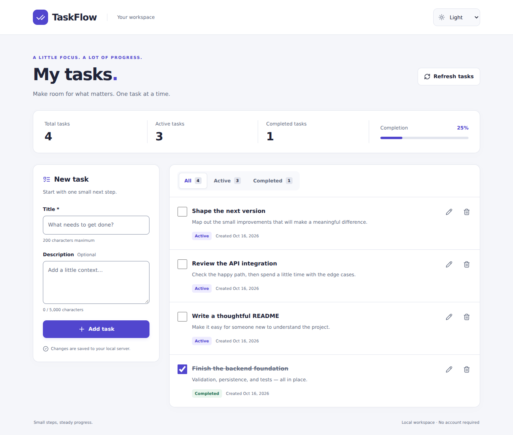
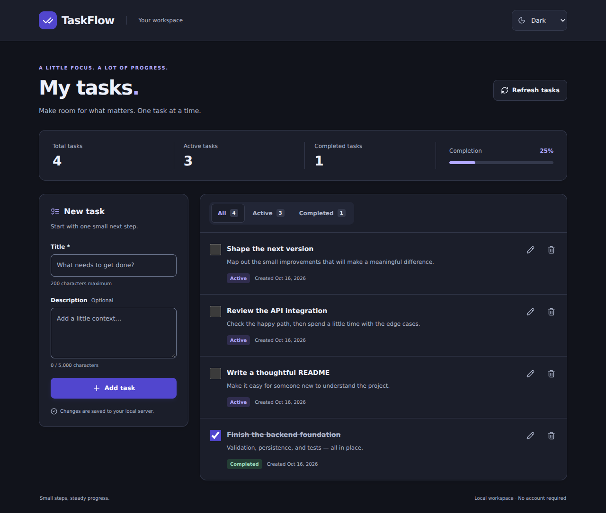
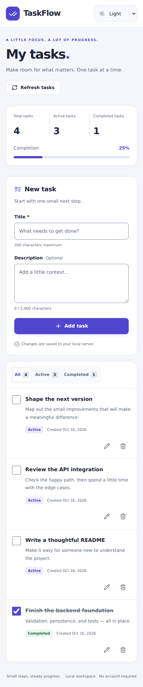
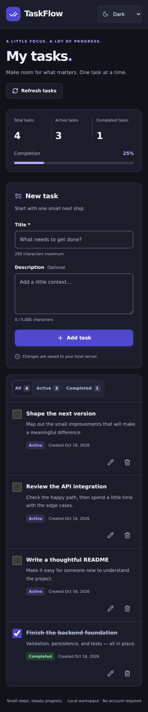

# TaskFlow

A focused task management application built with React, Express, and strict TypeScript.

**Status: V1.0.0 — Local application release. Not publicly deployed.**

Create, edit, complete and delete tasks through a responsive React interface connected
to the existing Express API. Filter by status, track real counts/progress, and choose
light, dark or system appearance. JSON persistence remains on the local backend.
No account is required; this is one shared local task collection.

## Technology

React 19, strict TypeScript, Vite 8, Tailwind CSS 4 and Lucide React; Node.js 24,
Express 5 and Zod 4; JSON file persistence behind a repository interface. Vitest,
React Testing Library and Supertest cover regression behavior. Optional Playwright
and axe-core checks exercise the real application.

## Quick start

Requires Node.js 24.x and npm 11.x. From the repository root:

```sh
npm ci
npm run dev
```

Open http://127.0.0.1:5173. The API runs at http://127.0.0.1:3001.
Vite proxies `/api` to the backend, avoiding unnecessary development CORS configuration.
Both development processes stop together when interrupted or when one exits.

Optional: copy `apps/api/.env.example` to `apps/api/.env` to override backend settings.
If you change the API port, update the proxy target in `apps/web/vite.config.ts` too.
The frontend has no environment variables.

## Commands

| Command                            | Purpose                                                  |
| ---------------------------------- | -------------------------------------------------------- |
| `npm run dev`                      | Start frontend and backend with reload                   |
| `npm run lint`                     | ESLint, zero warnings allowed                            |
| `npm run typecheck`                | Check both workspaces, tests and configuration           |
| `npm test`                         | Run Vitest, RTL and Supertest tests                      |
| `npm run build`                    | Compile API and bundle web                               |
| `npm run check`                    | Run lint, types, unit/integration tests and build        |
| `npm run test:browser`             | Optional real Chromium acceptance; install browser first |
| `npm start -w @taskflow/api`       | Run compiled API after building                          |
| `npm run preview -w @taskflow/web` | Preview built frontend locally                           |

Use `npm run dev` for the complete local application. The existing Vite development
proxy connects relative `/api` requests to Express. `vite preview` only previews the
built frontend and does not configure the development API proxy; it is not the
full-stack acceptance command or a production server. Production hosting and
same-origin `/api` reverse proxy configuration are not included yet.

## Structure and architecture

```text
apps/
  api/
    src/           HTTP routes, task service, repository contract and JSON adapter
    tests/         Isolated API, storage, concurrency and failure-path tests
    data/          Runtime JSON storage (gitignored)
  web/
    src/           API client, task state/components, themes and UI tests
.github/workflows/ CI quality gate
docs/             Architecture, API contract and checkpoint report
```

See [architecture](docs/ARCHITECTURE.md) for the repository boundary and
[API documentation](docs/API.md) for the implemented endpoints.

## Roadmap

1. **Foundation:** workspaces, strict TypeScript, React/Express scaffolding, tooling.
2. **Backend:** repository abstraction, serialized atomic JSON persistence, validation,
   task service/controllers and failure-path integration tests.
3. **Frontend:** full task UI, API integration, themes, responsive states and accessibility.
4. **Quality:** complete validation, security/accessibility review, screenshots and portfolio polish.

All four checkpoints are implemented. Publication remains subject to independent
review and explicit approval. See the [final audit](docs/CHECKPOINT-04.md) and
[proposed release notes](docs/RELEASE-NOTES-1.0.0.md).

## Using TaskFlow

- Add a title and optional description in **New task**. Adding a task selects **All**
  so the server-confirmed result is visible.
- Use a task checkbox to change completion. The UI waits for server confirmation.
- Edit through the pencil button. Save or cancel; Escape closes idle dialogs.
- Delete through the trash button and confirm. Cancel receives initial focus.
- Filter with **All**, **Active**, **Completed**. Counts always describe the full collection.
- Choose **System**, **Light** or **Dark** in the header. Only an explicit theme choice
  is stored in the browser; tasks remain on the server.
- Use **Refresh tasks** to pick up changes from another tab or recover after errors.
  An uncertain mutation blocks further writes until a successful refresh. Check the
  refreshed collection before manually resubmitting: POST has no idempotency keys.

## Local storage

Tasks are saved automatically to `apps/api/data/tasks.json` on first access.
Use `TASKS_FILE` in the API environment file for an alternative path. Relative
overrides resolve from the API process working directory. Keep custom data paths
outside Git or explicitly ignore them. Use one API process and one repository
instance per file; this adapter does not provide multi-process transactions.
Corrupt files return HTTP 503 and are never automatically reset. See the architecture
document for recovery steps and durability limitations.

See [Checkpoint 04](docs/CHECKPOINT-04.md) for final validation results, limitations,
manual acceptance steps and the changed-file inventory. [Checkpoint 02](docs/CHECKPOINT-02.md)
retains the backend PowerShell walkthrough and historical results.

## Screenshots

Real Chromium captures using fictional tasks (four tasks, one completed). Compact PNGs,
about 450 KiB combined. Mobile images show the full scrollable page.

| Desktop light                                                                                                            | Desktop dark                                                                                                 |
| ------------------------------------------------------------------------------------------------------------------------ | ------------------------------------------------------------------------------------------------------------ |
|  |  |

| Mobile light                                                                                      | Mobile dark                                                                                                          |
| ------------------------------------------------------------------------------------------------- | -------------------------------------------------------------------------------------------------------------------- |
|  |  |

## Validation

`npm run check` passed with **126 tests: 88 API and 38 frontend**. Real Chromium
and Firefox acceptance passed, including 22 axe-core scans with no detected
violations. WebKit, physical mobile devices, native browser zoom and screen readers
remain unverified. These checks are not WCAG or security certification.

Optional browser checks use disposable storage and require free ports 3001/5173:

```sh
npx playwright install chromium firefox
npm run test:browser
node scripts/browser-audit.mjs --browser=firefox
# Recreate the four screenshots after building:
node scripts/browser-audit.mjs --screenshots
```

Install browser system dependencies where required. Browser checks are intentionally
separate from the fast CI gate. See the final audit for environment-specific results.

## Security and limitations

This is a local, single-user application with **no authentication**. Anyone able to
call the API can read or change the shared collection. Keep it on loopback; do not
expose it publicly. Host/Origin checks accept only localhost, 127.0.0.1 and [::1]
(with optional ports). They reduce browser-origin risks but do not authenticate
clients: non-browser callers can forge headers. Arbitrary LAN hostnames are rejected.

There is no pagination, multi-process transaction support, offline queue or automatic
cross-tab synchronization. Keep backups of the JSON data. Public hosting would require
a separate security/deployment design, including access control, TLS, limits and
frontend response headers. The API CSP is not a frontend deployment policy.

## AI assistance

This project is developed with AI assistance for planning, code generation,
documentation, and review. It does not claim to be manually coded without AI.
Validation performed at each checkpoint is recorded in `docs/`; passing checks
are evidence of those checks, not a guarantee of defect-free software.

## License

MIT — see [LICENSE](LICENSE).
